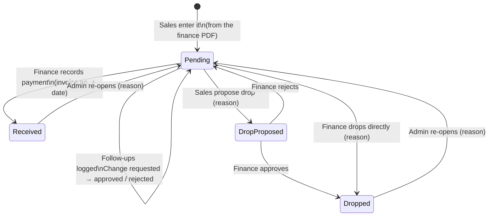
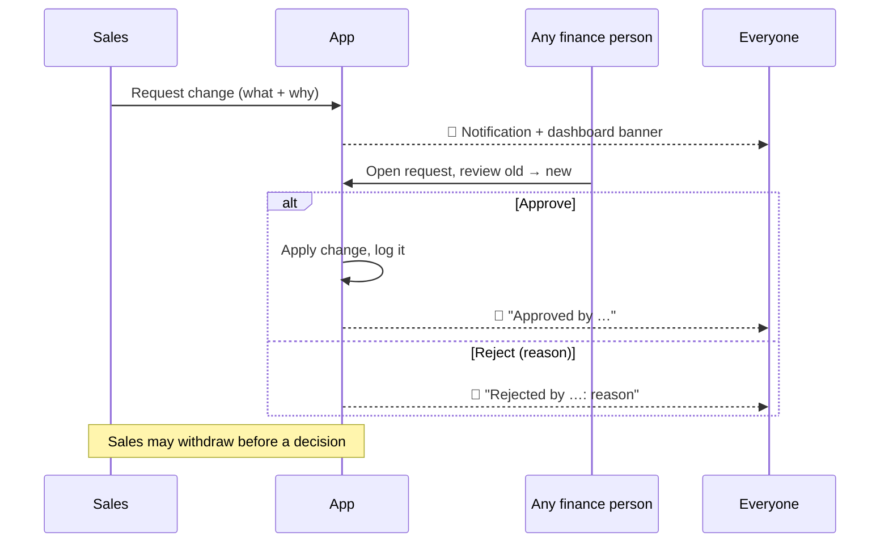
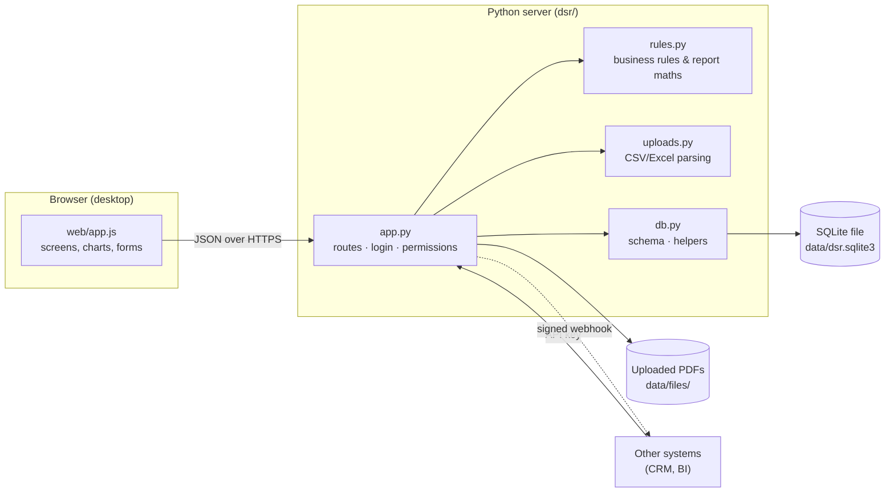
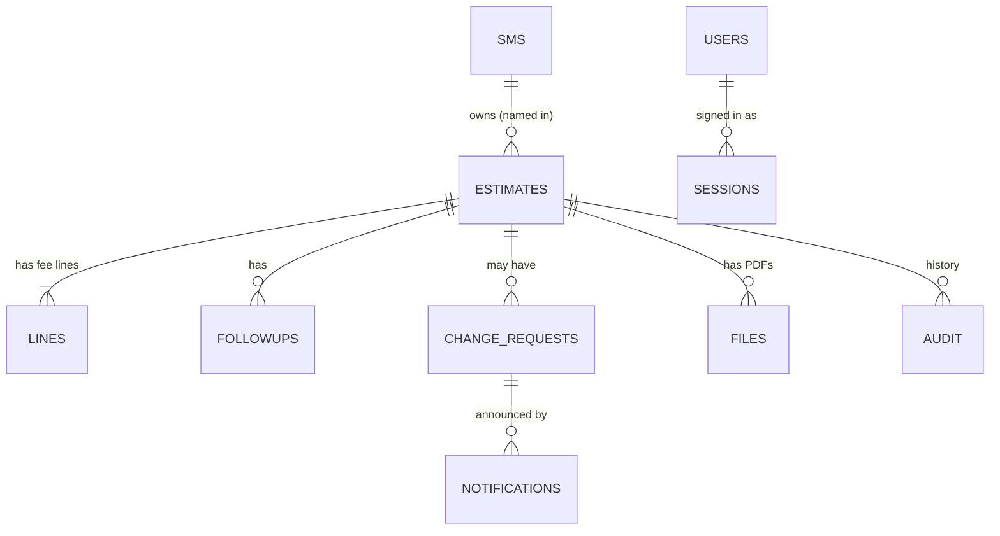

# Daily Sales Report

**One shared screen that replaces the daily Excel + email.**
Sales type in the estimates they raise, Finance records the payments, and everybody sees the same up-to-date picture: how much is waiting to be paid, how old it is, who is chasing it, and what changed today.

> If you only read one section, read **[1. The 2-minute version](#1-the-2-minute-version)** and **[4. The rules](#4-the-rules-in-plain-words)**.

---

## Contents
1. [The 2-minute version](#1-the-2-minute-version)
2. [Who does what](#2-who-does-what)
3. [Words used in this app](#3-words-used-in-this-app)
4. [The rules, in plain words](#4-the-rules-in-plain-words)
5. [The life of an estimate](#5-the-life-of-an-estimate)
6. [A tour of the screens](#6-a-tour-of-the-screens)
7. [How the numbers are worked out](#7-how-the-numbers-are-worked-out)
8. [Settings, limits and parameters](#8-settings-limits-and-parameters)
9. [Uploading a spreadsheet of estimates](#9-uploading-a-spreadsheet-of-estimates)
10. [Connecting other systems (CRM)](#10-connecting-other-systems-crm)
11. [Architecture (how it is built)](#11-architecture-how-it-is-built)
12. [Installing, running and looking after it](#12-installing-running-and-looking-after-it)
13. [What it does not do (yet)](#13-what-it-does-not-do-yet)
14. [Questions and troubleshooting](#14-questions-and-troubleshooting)

---

## 1. The 2-minute version

**The problem.** Every day the sales team received an Excel "Revenue" sheet by email. Numbers were typed by hand, the Summary tab had manual fixes in its formulas, and nobody could tell who had followed up on which old estimate.

**What this app does instead.**

| Before (Excel + email) | Now (this app) |
|---|---|
| Finance prepares the estimate, emails the PDF | Same — nothing changes here |
| Sales re-type details into a sheet | Sales type the details **once** into the app (and can attach the PDF) |
| Finance updates "Received / Dropped" by hand | Finance clicks **Record payment** or approves a **Drop** |
| Someone rebuilds the Summary and emails it | The dashboard is always live; Finance can also **Publish** a frozen copy of the day's numbers |
| "Did anyone call this customer?" | Every follow-up on an estimate older than 30 days has a visible **timeline** |
| "Who changed the amount?" | Sales **request** changes, Finance approves, everyone is notified, everything is logged |

**The big idea in one picture**

```
 Finance (outside the app)        Sales                           Finance                    Everyone
 ───────────────────────────      ─────────────────────────       ──────────────────────     ──────────────────
 Prepares estimate PDF  ──email─► Types it in (+ attaches PDF) ─► Customer pays?  ────────►  Dashboard updates
                                  Chases the customer              → "Record payment"        instantly
                                  Logs each follow-up              Customer walks away?
                                  Needs a correction?              → approves the "Drop"
                                  → "Request change" ────────────► Approves / rejects ─────► Notification bell
```

---

## 2. Who does what

There are three kinds of user. An administrator creates the accounts.

| | **Sales** | **Finance** | **Admin** |
|---|---|---|---|
| See the dashboard and every estimate | ✔ | ✔ | ✔ |
| Enter a new estimate (from the PDF), or upload a list | ✔ (must include themselves as a sales manager) | – | ✔ |
| Change an estimate that is already saved | **asks Finance** ("Request change") | ✔ directly | ✔ directly |
| Approve or reject a change request | – | ✔ **any** finance person | ✔ |
| Withdraw a change request | the person who asked | – | ✔ |
| Log a follow-up | on their own estimates | on any | ✔ |
| Propose to drop an estimate (with a reason) | their own | – | – |
| Approve / reject / make a drop | – | ✔ | ✔ |
| Record that the customer paid | – | ✔ | ✔ |
| Publish the day's report | – | ✔ | ✔ |
| Attach the estimate PDF | on their own | ✔ | ✔ |
| Re-open a closed (paid/dropped) estimate | – | – | ✔ |
| Manage users, the sales-manager list, API keys, the webhook | – | – | ✔ |

> **"Any finance person can do it"** — a change request is not assigned to a named person. The first finance user who acts on it settles it; everyone else then sees who did.

### A normal day

1. **Morning** – Finance emails new estimate PDFs. Sales type them in (a minute each) or upload a spreadsheet.
2. **During the day** – Sales call/WhatsApp/email customers and log each follow-up. If a PDF was wrong they raise a *change request*.
3. **When money arrives** – Finance opens the estimate, clicks **Record payment**, enters the invoice number and the date the money came in. The estimate turns green and drops out of "pending".
4. **When a deal is dead** – Sales propose a drop with a reason; Finance approves.
5. **End of day** – Finance clicks **Publish today's report**. That freezes today's numbers under **Reports** so they can be looked at later exactly as they were.

---

## 3. Words used in this app

| Word | Meaning |
|---|---|
| **Estimate** | The quotation / proforma invoice sent to a customer. One estimate can contain several fee lines. |
| **Fee line / Fee type** | One kind of charge inside an estimate: **Annual fees**, **Set-up fees**, **Integration** or **Customisation**. An estimate has at most one line per type. |
| **Pending** | The customer has not paid yet. (This is the main "open" state.) |
| **Received** | The customer paid **in full**. Finance has entered the tax-invoice number and the payment date. In the old sheet this was "converted to tax invoice". |
| **Dropped** | The estimate is written off — the deal will not happen. |
| **Primary salesperson** | The *first* name on an estimate. They get the credit. Other names are "also credited" on a joint deal. |
| **Team** | The full list of names on an estimate, in order — "Arshdeep & Meisheil" and "Meisheil & Arshdeep" are **different** teams because the primary differs. |
| **Report month** | The month an estimate is counted in. Normally the month of its date. It can differ (an estimate dated 8 Oct can be filed under September, as in the old sheet). |
| **Opening** | Estimates from earlier months that were still unpaid on the 1st of the month. |
| **New** | Estimates counted in the month. |
| **Converted** | Estimates paid in the month. |
| **Closing** | What is still unpaid at the report date: `Opening + New − Converted − Dropped`. |
| **Age** | Days between the estimate date and the report date. |
| **Follow-up** | A logged touch-point with the customer about an unpaid estimate (call, email, WhatsApp, meeting). |
| **Change request** | Sales asking Finance to correct a saved estimate. |
| **Published report** | A frozen copy of one day's numbers. |

---

## 4. The rules, in plain words

### Entering an estimate
- The **estimate number must be unique** (spaces are ignored). Two estimates can never share a number.
- Required: number, date, customer, at least one **sales manager** (the first is primary), at least one **fee line**.
- The **date cannot be in the future**. The **report month cannot be in the future**.
- Each fee amount must be **more than zero**. You cannot use the same fee type twice in one estimate — combine them.
- Up to **3 sales managers** per estimate. They must be on the sales-manager list.
- A sales user can only enter estimates that **include themselves**.
- You may attach the finance PDF (PDF / PNG / JPG, **up to 10 MB**).
- A new estimate always starts as **Pending**.

### Changing an estimate that is already saved
- **Sales cannot edit it directly.** They press **Request change**, change what is wrong and write **why** (at least 5 characters).
- Only **one open request per estimate** at a time. To send a different one, withdraw the first.
- A request must actually change something.
- **Everyone is notified** (the bell in the top bar, plus a banner on the dashboard) as soon as it is raised.
- **Any finance person** can **Approve** (the change is applied at once) or **Reject** (a reason is required, so sales know what to fix).
- The requester can **withdraw** it before it is decided.
- **Safety check:** if someone changed the estimate *after* the request was raised, approval is refused ("the estimate changed after this was requested"). Finance rejects it and sales ask again. This stops an old request from overwriting newer information.
- Finance and admin can edit directly (their edits are still logged). A closed estimate cannot be changed at all until an admin re-opens it.
- **Not** covered by requests (sales can do these freely): logging follow-ups, attaching a PDF, and proposing a drop.

### Getting paid
- **Payment is in full only.** Finance marks the estimate paid and enters the **date** the money was received. There are no part-payments.
- Required: **tax invoice number** and **payment date**. The payment date cannot be in the future or before the estimate date. Invoice date (defaults to the payment date) and bank / UTR reference are optional.
- Once paid, the estimate is **locked**.

### Dropping an estimate
- Sales **propose** a drop with a reason (at least 5 characters). Finance **approves** (the estimate is written off, dated that day) or **rejects** (it stays pending).
- Finance can also drop directly, with a reason.
- There is **no "expected drop date"** anywhere in the app — a drop is simply recorded on the day Finance approves it.
- Once dropped, the estimate is **locked**.

### Following up (estimates older than 30 days)
- Any **pending** estimate **older than 30 days** appears on the **Follow-ups** screen with its complete timeline.
- Each follow-up records: **date, how** (call / email / WhatsApp / meeting / other), **who you spoke to** (optional), **what was discussed** (at least 5 characters) and an optional **next follow-up date**.
- The follow-up date cannot be in the future or before the estimate date. Follow-ups cannot be deleted (add a new one to correct).
- Each estimate gets a traffic-light flag:

| Flag | Meaning |
|---|---|
| 🔴 **No follow-up yet** | Nothing has ever been logged. |
| 🟠 **Follow-up overdue** | The *next follow-up date* in the latest entry has passed — **or**, if no next date was set, the last follow-up is **more than 7 days old**. |
| 🟢 **On track** | Anything else. |

### Everyone can see everything
- All users see all estimates, the dashboard, every follow-up timeline and every change request. Roles limit who can **act**, not who can **look**.

### Nothing is lost
- **Every action is logged** with who did it and when (shown as *History* on each estimate).
- Two people editing the same estimate at once cannot overwrite each other — the second person is told to reload.
- Imported (legacy) estimates are flagged as such.

---

## 5. The life of an estimate



And the change-request mini-flow:



---

## 6. A tour of the screens

| Screen | Who it is for | What you do there |
|---|---|---|
| **Dashboard** | Everyone | The live picture. Top row: Opening → New → Converted → Dropped → Closing. Below: conversions per month, ageing, the sales-manager table (click a name to see their pending estimates), the fee-type table and the ten biggest pending estimates. Choose the **month** and the **credit** mode. Alert buttons appear when something needs attention (change requests, follow-ups, drop requests). |
| **Estimates** | Everyone | Search and filter every estimate. **+ New estimate**, **Upload file…**, and open any row for the full detail, follow-ups, history and actions. |
| **Follow-ups** | Everyone | Every pending estimate over 30 days (or 60 / 90) with its timeline, worst first. **Log follow-up** right from the card. Sales see their own by default. |
| **Finance desk** | Finance | Three lists: **change requests** (approve / reject), **drop requests**, and **pending estimates, oldest first** (open one to record payment). |
| **Reports** | Everyone | The frozen daily reports Finance published. |
| **Rules** | Everyone | A short in-app version of section 4. |
| **Admin** | Admin | Users, sales-manager list, API keys for other systems, webhook. |
| **🔔 bell** | Everyone | Shared notifications: change requested / approved / rejected / withdrawn. A red number shows how many you have not seen. It refreshes by itself about every 20 seconds. |

Colours: blue = annual fees, orange = set-up fees, green = integration, amber = customisation. Ageing uses a light-to-dark blue (older = darker).

This application is designed for a **desktop browser** (minimum width 1024 px). There is no phone layout.

---

## 7. How the numbers are worked out

### The roll-forward (the heart of the dashboard)

```
   Opening   estimates from earlier months, still unpaid on the 1st
 + New       estimates counted in this month
 − Converted estimates paid this month
 − Dropped   estimates dropped this month
 ─────────
 = Closing   what is still unpaid
```

**Worked example** (invented numbers, October):

| | ₹ |
|---|---|
| Opening (unpaid from September and before) | 80,00,000 |
| + New (raised in October) | 6,00,000 |
| − Converted (paid in October) | 4,00,000 |
| − Dropped | 2,00,000 |
| **= Closing** | **80,00,000** |

Because the app stores the **month each estimate belongs to** and the **date it was paid/dropped**, you can pick any month and get the correct roll-forward — nobody has to rebuild the sheet.

### Ageing
Closing estimates are grouped by days since the estimate date: **0–30, 31–60, 61–90, 90+**. A day count of exactly 30 is in the first group; 31 is in the second, and so on.

### Credit modes (the "Credit" drop-down)
How a joint deal ("Arshdeep & Meisheil") appears in the sales-manager table:

| Mode | What you see |
|---|---|
| **Team, primary first** *(default, matches the old sheet)* | One row per team. "Arshdeep & Meisheil" and "Meisheil & Arshdeep" are separate rows. The primary name is in bold. |
| **Primary salesperson only** | The whole amount goes to the primary. |
| **Split equally** | The amount is shared equally between the names. |

### Counts vs. amounts
A "count" is a number of **estimates** (not fee lines). An estimate with three fee lines counts once. (The old Excel counted rows, so counts can differ slightly from the old sheet; **amounts match**.)

### Conversions per month
The bar chart counts estimates by the month **payment was received**. It starts from the first month in which a payment was recorded in the app.

### Published reports
"Publish today's report" saves a copy of the dashboard's numbers. Editing data later never changes a published copy.

---

## 8. Settings, limits and parameters

### Business parameters (fixed in the code — `dsr/rules.py`)

| Parameter | Value |
|---|---|
| Fee types | Annual fees · Set-up fees · Integration · Customisation |
| Estimate statuses | Pending · Received · Dropped |
| Age groups | 0–30 · 31–60 · 61–90 · 90+ days |
| Follow-up tracking starts | pending **more than 30 days** (screen can also show 60 / 90) |
| Follow-up "overdue" with no next date | **more than 7 days** since the last follow-up |
| Follow-up types | Call · Email · WhatsApp · Meeting · Other |
| Sales managers per estimate | 1 to 3 (first = primary) |
| Amount per fee line | greater than 0, up to 2 decimals |
| Notes on an estimate | up to 500 characters |
| Follow-up note | 5 to 1,000 characters; "spoke to" up to 120 |
| Reasons (drop, reject, re-open, change request) | at least 5 characters |
| Estimate number | spaces removed; must be unique |

### Security and technical limits

| Parameter | Value |
|---|---|
| Password | at least 8 characters, stored hashed (scrypt) |
| Username | 3–30 characters: letters, digits, `.` `_` `-` |
| Sign-in lasts | 7 days (then sign in again) |
| Attachment / upload size | 10 MB |
| Attachment types | PDF, PNG, JPG |
| Bulk upload types | CSV; Excel (.xlsx) if the optional `openpyxl` package is installed |
| Notifications refresh | every 20 seconds while the tab is visible |
| Notifications shown | latest 40 (the server never returns more than 100) |
| API key roles | `read` · `sales` · `finance` |
| Webhook | HTTPS only (plain http allowed only for localhost); one attempt, 8 second timeout; signed with HMAC-SHA256 |
| Published reports listed | latest 60 |

### Environment variables (set when starting the server)

| Variable | Default | Meaning |
|---|---|---|
| `PORT` | `8080` | Port to listen on |
| `HOST` | `127.0.0.1` | Use `0.0.0.0` to allow other computers to connect |
| `DSR_DB` | `data/dsr.sqlite3` | Where the database file lives (uploaded files go in a `files/` folder beside it) |
| `DSR_ADMIN_PASSWORD` | random | Password for the first `admin` account (otherwise a random one is printed once on first run) |
| `DSR_TODAY` | today | Pretend today is this date (`YYYY-MM-DD`) — for testing only |

---

## 9. Uploading a spreadsheet of estimates

On **Estimates → Upload file…** choose a CSV (or Excel). The app shows a **preview first**; nothing is saved until you press **Import**. Rows with problems are skipped and explained.

One row per **fee line**. Columns (the header names are flexible; a template can be downloaded from the dialog):

| Column | Required | Example |
|---|---|---|
| Estimate Date | yes | `2026-10-13`, `13/10/2026`, `13-Oct-2026` |
| Estimate Number | yes | `EST-26-27/264` |
| Customer Name | yes | `Acme Pvt Ltd` |
| Subtotal | yes | `50000` or `1,00,000` |
| SM | yes | `Arshdeep` or `Arshdeep & Meisheil` (first = primary) |
| Category | yes | `Annual fees`, `Set-up fees`, `Integration`, `Customisation` |
| Report Month | no | `2026-10` or `Oct-26` |

Rows with the same estimate number become **one estimate with several fee lines**. Duplicates of numbers already in the app, unknown sales managers, bad dates and zero amounts are flagged. A sales user can only upload estimates that include themselves.

---

## 10. Connecting other systems (CRM)

Other software (for example a CRM built by someone else) talks to this app through a small **web API**, using a key an admin creates under **Admin → API access**. It can create estimates, ask for changes, log follow-ups, upload files and read reports, and it can receive **webhook** messages when something happens (estimate created, change requested/approved/rejected, follow-up logged, paid, dropped…).

Full details and examples: **[docs/API.md](docs/API.md)**.

Good to know:
- Sending the same CRM record twice (using `external_ref`) will **not** create a duplicate.
- A `sales` key cannot edit directly — it must send a *change request*, exactly like a person.
- Webhook delivery is "best effort" (one try). The CRM should re-read estimates if it misses one.

---

## 11. Architecture (how it is built)

### In one paragraph
A tiny web server written with **only Python's standard library** stores everything in a single **SQLite** file and serves a plain **HTML/JavaScript** page. There is nothing to install except Python 3.10 or newer. All business rules live in one small, testable module (`dsr/rules.py`); the server (`dsr/app.py`) checks who is allowed to do what, and the page (`web/app.js`) only displays and collects input.

### The big picture



### Who is responsible for what

| Piece | File | Responsibility |
|---|---|---|
| **Screens** | `web/index.html`, `web/app.js`, `web/style.css` | Shows data, collects input, draws charts, polls for notifications. Contains **no** business rules. |
| **Server / API** | `dsr/app.py` | Signs people in, checks **role permissions**, applies actions (record payment, approve change…), writes the history log, sends webhooks. |
| **Rules & maths** | `dsr/rules.py` | Validation (dates, amounts, owners), ageing buckets, the roll-forward, follow-up flags, comparing an estimate with a proposed change. Pure functions — easy to test. |
| **Upload reader** | `dsr/uploads.py` | Reads CSV/Excel, understands several date and amount styles, checks every row. |
| **Database layer** | `dsr/db.py` | Creates the tables, password hashing, small helpers (history log, notifications). |
| **One-time import** | `dsr/import_xlsx.py` | Loads the old Excel workbook into the app. |
| **Tests** | `tests/` | Automated checks for the rules and the upload reader. |

### What is stored (the tables)



| Table | Holds |
|---|---|
| `estimates` | One row per estimate: number, date, report month, customer, owners (in order), status, close date, invoice details, drop reason, notes, a version number. |
| `lines` | The fee lines (fee type + amount) of each estimate. |
| `followups` | The follow-up timeline entries. |
| `change_requests` | Each request: who/when/why, the exact field-by-field changes (old → new), status, who decided and when. |
| `notifications` · `notif_reads` | The shared notification feed, and how far each person has read it. |
| `audit` | The history log of every action. |
| `files` | Attached documents (the files themselves are stored on disk). |
| `snapshots` | Published daily reports (stored as a frozen copy). |
| `users` · `sessions` · `sms` | Accounts, sign-in sessions, and the list of sales managers. |
| `api_keys` · `settings` | Keys for other systems (only a hash is stored) and the webhook address. |

### What happens when someone clicks a button (example: "Approve" a change)

1. The browser sends a small JSON message to the server with the person's sign-in cookie.
2. The server checks the sign-in and the **role** ("is this a finance user?").
3. It re-reads the estimate and runs the safety check ("has it changed since the request?").
4. It runs the rules in `rules.py` on the new values.
5. In **one database transaction** it applies the change, marks the request approved, writes the history entry and creates the notification — all or nothing.
6. It tells any configured webhook, and answers the browser, which refreshes the screen. Other people's screens pick up the notification within ~20 seconds.

### Design decisions (and why)

| Decision | Reason |
|---|---|
| **Rules separate from screens** | The same rules protect the screens, the CSV upload and the CRM API — nobody can bypass them from one side. |
| **Roll-forward calculated from stored dates, not stored totals** | Any month or date can be re-created; no "stale totals". |
| **Optimistic locking (`version`)** | Two people editing at once cannot silently overwrite each other. |
| **Change requests store *field-level* old → new** | Reviewers see exactly what changes, and stale requests are detected. |
| **SQLite + standard library** | Zero set-up, one file to back up; plenty for a sales team. |
| **Plain JavaScript, no frameworks, no internet needed** | Nothing to build; works on a locked-down office network; charts are drawn in-house. |
| **Everything visible, actions restricted** | Matches how the team already shares the daily report. |

### Security in brief
- Passwords are **hashed** (scrypt), never stored as typed. Sign-in uses an HTTP-only, same-site cookie.
- API keys are shown **once**; only a hash is stored; keys can be revoked.
- Every action is permission-checked **on the server** (hiding a button is never the only protection).
- Uploaded files are stored with random names and served only to signed-in users, with a safe file type.
- Webhooks are signed so the receiver can verify they came from here.
- **Not built in:** HTTPS (put it behind a reverse proxy — see below), login lock-out after repeated failures, self-service password reset.

### Size and limits
One server process, one SQLite file: comfortably a team of dozens of users and tens of thousands of estimates. If you ever outgrow that, only `dsr/db.py` and the SQL need to move to a bigger database.

### Project layout

```
README.md            this file
docs/API.md          integration guide for the CRM / other systems
dsr/
  app.py             web server, login, permissions, all actions
  rules.py           business rules and the report maths
  uploads.py         CSV / Excel reader
  db.py              database tables and helpers
  import_xlsx.py     one-time import from the old Excel workbook
web/
  index.html  app.js  style.css      the screens
tests/               automated tests
data/                created at run time: the database and uploaded files (not in git)
```

---

## 12. Installing, running and looking after it

### Requirements
Python **3.10 or newer**. Nothing else. (Optional: `pip install openpyxl` to read Excel files for bulk upload and for the one-time import.)

### Start it
```bash
python3 -m dsr
# open http://localhost:8080
```
On the **first run** the screen prints the password for the `admin` user (or set `DSR_ADMIN_PASSWORD` before starting). Sign in as `admin`, then open **Admin** to:
1. add the **sales managers** (names as they appear on estimates),
2. add **users** — a *sales* user is linked to one sales manager; *finance* users are not linked,
3. (optional) create an **API key** and set the **webhook** for the CRM.

### Load the old Excel (one time)
```bash
pip install openpyxl
python3 -m dsr.import_xlsx Revenue.xlsx --as-of 2026-10-13
```
It reads the three data sheets (*Current Month*, *Previous Month*, *Dropped till last Month*). The old **Summary** sheet is ignored and **Reporting** is the sheet the app reproduces. Notes:
- The workbook has no payment/drop **dates**, so already-paid or dropped rows get the `--as-of` date (older drops get 30 Sep). Roll-forwards **before** the import month are therefore approximate; from then on, dates are real.
- Dropped rows in the old sheet had no fee type, so they default to *Set-up fees*.

### Run it for real (recommended set-up)
1. Run on a small always-on computer or server: `HOST=127.0.0.1 PORT=8080 python3 -m dsr`.
2. Put a **reverse proxy with HTTPS** in front (Caddy, nginx, a cloud load balancer). Example Caddy file:
   ```
   sales-report.yourcompany.com {
       reverse_proxy 127.0.0.1:8080
   }
   ```
3. Keep it running with your system's service manager (for example a `systemd` service).
4. Set the server's clock/time-zone to **India Standard Time** — "today" follows the server's date.

### Backups (important)
Everything lives in the `data/` folder. Copy `data/dsr.sqlite3` **and** `data/files/` to safe storage every day (for example with a nightly `cp`/`rsync`). To restore, stop the server, put the files back, start again.

### Upgrading
Stop the server, replace the code, start it again. New tables/columns are added automatically; existing data is kept.

### Tests
```bash
python3 -m unittest discover -s tests -t .
```

---

## 13. What it does not do (yet)

- **No email sending.** The dashboard is live; Finance can publish a frozen copy. (A daily email linking to it is an easy add-on.)
- **No part-payments** — payment is in full, by design.
- **No automatic scheduling** of "Publish today's report" (it is a button).
- **No HTTPS, login lock-out or password reset** built in (see Security).
- **Notifications are in the app**, not by email or phone push.
- **Desktop only** — no phone layout.
- **Imported history before the import month is approximate** (see section 12).
- **Webhooks make one attempt** and do not retry.
- **Customer names are free text** — the same customer typed two ways counts as two customers.

Ideas that would add the most value next: a nightly auto-publish, an emailed link to the daily report, a customer master list (to avoid duplicate spellings), and reminder emails for overdue follow-ups.

---

## 14. Questions and troubleshooting

**"I saved an estimate and now I can't edit it."**
By design: use **Request change**. Finance is notified and any finance person can approve it.

**"It says the estimate changed after my request."**
Someone (usually Finance) edited it in between. Ask for the change again — it will compare against the latest version.

**"Why can't I mark it paid / drop it?"**
Only Finance (and Admin) do that. Sales can *propose* a drop.

**"My estimate isn't in 'Closing'."**
It has been paid or dropped — or its *Report month* is later than the month you selected.

**"Opening or New differs from my old sheet."**
Check the estimate's **Report month**. The app counts an estimate in its report month, not necessarily the month of its date. Closing should match.

**"The follow-up board says 'No follow-up yet' but I called them."**
Calls only count once they are **logged**. Open the estimate (or the board card) → **Log follow-up**.

**"I can't sign in / the page keeps asking me to sign in."**
Sessions last 7 days. If the server was restarted with a different database file, the old sign-in is gone — sign in again.

**"The notification badge didn't appear."**
It refreshes about every 20 seconds while the tab is visible. Click the 🔔 to refresh immediately.

**"Upload says columns are missing."**
Download the template from the upload dialog and keep its header names.

**"Excel upload doesn't work."**
Install the optional package (`pip install openpyxl`) on the server, or save the sheet as CSV.

**"Who changed this amount, and when?"**
Open the estimate → **History**. Every change, request, approval, payment, drop and follow-up is listed with the person and time.
